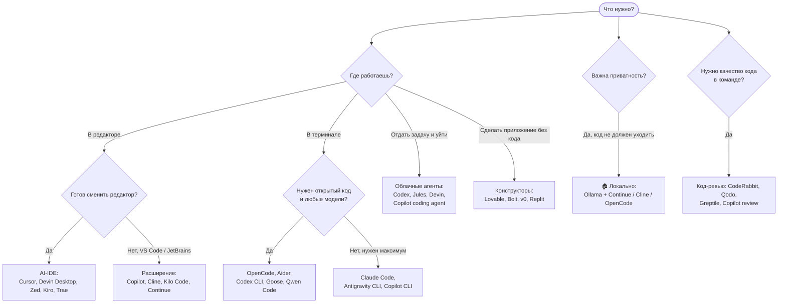
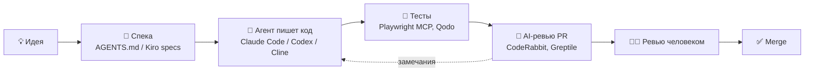
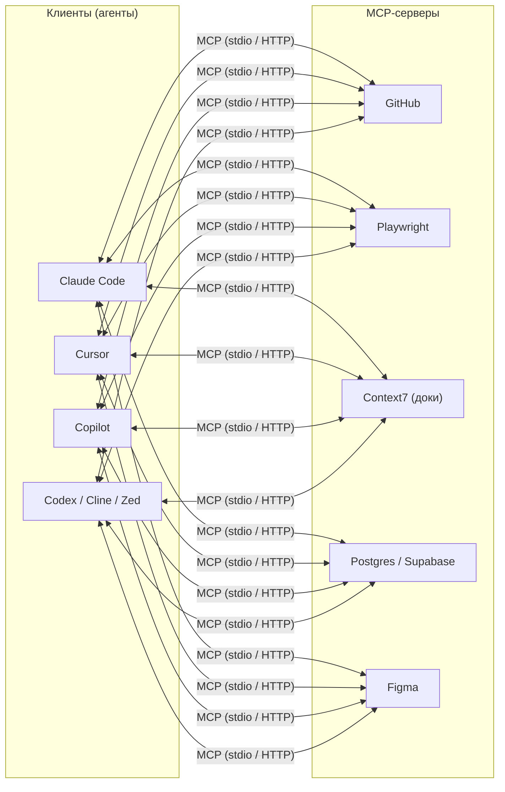

# 🤖 Awesome AI DevTools на русском (2026)

**Самый полный каталог ИИ-инструментов для разработчиков на русском языке:** AI-IDE, расширения, терминальные агенты, облачные агенты, MCP, код-ревью, тестирование, LLMOps, локальные модели, российские сервисы. С таблицами, схемами выбора и готовыми стеками.

Здесь собраны **сотни инструментов**, которые помогают писать, проверять и поддерживать код с помощью нейросетей: от автодополнения в редакторе до автономных агентов, которые сами берут задачу из трекера и приносят готовый pull request. Для каждого инструмента — короткое описание на русском и метки: открытый код, бесплатный тариф, работа с локальными моделями, свой API-ключ, поддержка MCP, российский сервис.

Подойдёт начинающим, которые выбирают первый ИИ-помощник, опытным разработчикам, которые строят свой стек агентов, и командам, которым нужны код-ревью, тесты и контроль расходов. Отдельно — [полный каталог на 281 инструмент](catalog/polnyy-katalog.md), [уроки и теория](docs/04-teoriya.md), бесплатные и приватные варианты без зарубежных сервисов.

⭐ **Поставь звезду — список обновляется каждый месяц.**

---

## 🏷 Легенда

| Метка | Значение |
|---|---|
| 🟢 | Открытый исходный код |
| 🆓 | Есть бесплатный тариф или полностью бесплатно |
| 🏠 | Работает с локальными моделями (Ollama, LM Studio, llama.cpp) |
| 🔑 | BYOK — можно подключить свой API-ключ любого провайдера |
| 🔌 | Поддерживает MCP |
| 🇷🇺 | Российский сервис |
| ⭐ | Выбор редакции: лучший в категории |

---

## 📡 Топ ресурсы, чтобы следить за ИИ

| | Ресурс | Что внутри |
|---|---|---|
| [🧠](https://t.me/+-DTW9e5kyZ5jNGFi) | **[Machine Learning](https://t.me/+4vxN5vuxQXQ2NTky)** | Экспертный разбор ИИ-моделей и вся база для работы с ними: дайджесты лучших проектов, разбор кода, инструкции по запуску LLM, подготовка к собеседованиям и многое другое |
| [📚](https://t.me/+64ytM2_MgJozZTEy) | **[Data Science](https://t.me/+yLYl2dE5U8FjYzVi)** | Редкая литература, статьи, курсы и уникальные гайды для ML-специалистов любого уровня. Читайте, развивайтесь, практикуйте |
| 💼 | **[Machine Interview](https://t.me/+Gncl6NEJXOo4ODIy)** | База из [1900 вопросов с собеседований](https://t.me/+XKbJXlBwqBExOWEy) по машинному обучению. Изучите популярные вопросы, и оффер не заставит себя ждать |
| 🔝 | **[Папка ИИ-ресурсов](https://t.me/addlist/2Ls-snqEeytkMDgy)** | Здесь мы собрали целый кладезь полезных ИИ-ресурсов для прокачки |

---

## 📚 Полный каталог и уроки

В этом README — лучшие инструменты в каждой категории, сравнения и готовые стеки. Если нужно больше:

| Раздел | Что внутри |
|---|---|
| 📚 [Полный каталог (281 инструмент)](catalog/polnyy-katalog.md) | Все инструменты из [awesome-ai-devtools](https://github.com/jamesmurdza/awesome-ai-devtools) с описаниями на русском: 20 категорий, включая нишевые CLI-утилиты, оркестраторы, песочницы, трекеры токенов и MCP-серверы |
| 🧭 [Урок 01. Как выбрать инструмент](docs/01-kak-vybrat.md) | Пошаговый выбор по среде, приватности, задачам и бюджету; как честно сравнить 2–3 инструмента |
| 🏠 [Урок 02. Локальные модели](docs/02-lokalnye-modeli.md) | Ollama + Continue, Cline, Zed, Aider, Codex CLI: бесплатно и без отправки кода наружу |
| 🔌 [Урок 03. MCP, AGENTS.md и навыки](docs/03-mcp-i-agents-md.md) | Что писать в AGENTS.md, как подключать MCP-серверы, безопасность и экономия контекста |
| 🧠 [Урок 04. Теория: как устроены агенты](docs/04-teoriya.md) | Токены и контекст, агентный цикл, поиск по коду, почему агент ошибается, как ставить задачи, стоимость, бенчмарки, модель угроз |

---

## 📑 Содержание

- [Что изменилось в 2026 году](#-что-изменилось-в-2026-году)
- [Как выбрать инструмент: схема](#-как-выбрать-инструмент-схема)
- [Готовые стеки](#-готовые-стеки)
- [🧠 Теория за 5 минут](#-как-работают-ии-агенты-для-кода-теория-за-5-минут)
- [📚 Полный каталог (281 инструмент) и уроки](#-полный-каталог-и-уроки)
- **Писать код**
  - [AI-IDE (редакторы с ИИ)](#-ai-ide-редакторы-с-ии)
  - [Расширения для IDE](#-расширения-для-ide)
  - [Терминальные агенты](#️-терминальные-агенты)
  - [CLI-утилиты](#-cli-утилиты)
  - [Облачные (асинхронные) агенты](#️-облачные-асинхронные-агенты)
- **Создавать приложения и интерфейсы**
  - [Конструкторы приложений](#-конструкторы-приложений)
  - [Генерация UI и дизайн → код](#-генерация-ui-и-дизайн--код)
- **Качество кода**
  - [Код-ревью](#-код-ревью)
  - [Тестирование и QA](#-тестирование-и-qa)
  - [Безопасность](#-безопасность)
  - [Понимание кодовой базы и документация](#-понимание-кодовой-базы-и-документация)
- **Инфраструктура агентов**
  - [MCP: протокол, серверы, каталоги](#-mcp-протокол-серверы-каталоги)
  - [Параллельные агенты и оркестрация](#-параллельные-агенты-и-оркестрация)
  - [Песочницы для агентов](#-песочницы-для-агентов)
  - [Контекст для агентов](#-контекст-для-агентов)
- **Строить свои ИИ-продукты**
  - [Фреймворки для агентов и LLM-приложений](#-фреймворки-для-агентов-и-llm-приложений)
  - [LLMOps: шлюзы, наблюдаемость, оценка](#-llmops-шлюзы-наблюдаемость-оценка)
  - [Учёт токенов и расходов](#-учёт-токенов-и-расходов)
- **Модели и железо**
  - [Локальный запуск моделей](#-локальный-запуск-моделей)
  - [Открытые модели для кода](#-открытые-модели-для-кода)
- **Прочее**
  - [Базы данных и SQL](#-базы-данных-и-sql)
  - [Git](#-git)
  - [Десктоп-приложения](#-десктоп-приложения)
  - [🇷🇺 Российские инструменты](#-российские-инструменты)
- [Сравнительные таблицы](#-сравнительные-таблицы)
- [Бенчмарки и рейтинги](#-бенчмарки-и-рейтинги)
- [Другие awesome-списки и ресурсы](#-другие-awesome-списки-и-ресурсы)
- [FAQ](#-faq)
- [Как добавить инструмент](#-как-добавить-инструмент)

---

## 🧠 Как работают ИИ-агенты для кода: теория за 5 минут

| Понятие | Коротко | Что из этого следует |
|---|---|---|
| **Токены и контекстное окно** | Модель видит ограниченный объём текста: правила, историю, прочитанные файлы, вывод команд | Одна задача — одна сессия; длинный «грязный» контекст ухудшает ответы и дорожает |
| **Агентный цикл** | Модель выбирает инструмент (прочитать файл, найти, править, запустить команду), видит результат и повторяет, пока задача не решена | Тесты, линтер и типы — главная обратная связь: без них агент «думает, что всё работает» |
| **Поиск по коду** | grep, семантический поиск по эмбеддингам, LSP, карта репозитория, документация через MCP | Опиши структуру проекта в AGENTS.md — агент потратит меньше токенов на разведку |
| **Автодополнение (FIM)** | Маленькая быстрая модель дописывает код по тексту до и после курсора | Для подсказок нужна скорость, для агента — «ум»: это разные модели |
| **Кэш промпта** | Повторяющееся начало контекста обрабатывается в разы дешевле | Стабильный системный промпт и AGENTS.md экономят деньги |
| **Галлюцинации** | Модель уверенно предлагает несуществующие функции и пакеты | Свежая документация (Context7), закреплённые версии, проверка зависимостей |
| **Prompt injection** | Вредоносные инструкции в веб-странице, issue или README зависимости | Не давай агенту одновременно доступ к секретам, недоверенному контенту и сети |
| **Параллельные агенты** | Несколько агентов в отдельных git worktree над независимыми задачами | Узкое место — твоё ревью, поэтому параллель только с хорошими тестами |

**Как ставить задачу агенту:** цель → контекст (какие файлы, образец похожей фичи) → ограничения (без новых зависимостей, не трогать API) → критерий готовности (какие тесты и проверки должны пройти). Для крупных задач сначала попроси план без правок, утверди его и только потом запускай выполнение.

📖 Подробно, со схемами и примерами — [урок 04: теория](docs/04-teoriya.md).

---

## 🆕 Что изменилось в 2026 году

| Событие | Что это значит для тебя |
|---|---|
| **Агенты стали стандартом.** Автодополнение отходит на второй план, главный режим теперь «опиши задачу, агент сделает PR» | Учись писать задачи и правила (`AGENTS.md`, `CLAUDE.md`), а не только код |
| **Windsurf стал Devin Desktop** (Cognition) | Пользователи Windsurf переезжают в экосистему Devin |
| **Roo Code закрыт** (май 2026), репозиторий в архиве | Альтернативы: [Cline](https://github.com/cline/cline), [Kilo Code](https://github.com/Kilo-Org/kilocode) и форки |
| **Antigravity CLI** (`agy`) **заменил Gemini CLI для большинства пользователей** | Gemini CLI остаётся для платного API и Code Assist |
| **Goose передан в Linux Foundation** (AAIF) | Проект стал вендор-нейтральным |
| **MCP стал общим стандартом** для подключения инструментов | Один MCP-сервер работает в Claude Code, Cursor, Copilot, Codex и других |
| **Параллельные агенты** в отдельных git worktree | Появился целый класс оркестраторов: Conductor, Vibe Kanban, Superset и др. |
| **Сильные открытые модели для кода** (DeepSeek V4.1, Qwen3-Coder, Kimi, GLM, Devstral) | Агенты можно гонять дёшево или полностью локально |

> 💡 Рынок меняется каждый месяц. Если видишь устаревшую информацию, [открой Issue](https://github.com/justxor/awesome-ai-devtools-ru/issues/new?template=update.md).

---

## 🧭 Как выбрать инструмент: схема

---

## 🧰 Готовые стеки

| Сценарий | Редактор / агент | Модели | Ревью и тесты | Стоимость |
|---|---|---|---|---|
| 🆓 **Бесплатно, для старта** | VS Code + [Cline](https://github.com/cline/cline) или [Continue](https://github.com/continuedev/continue) | Бесплатные тарифы провайдеров, OpenRouter free | [PR-Agent](https://github.com/The-PR-Agent/pr-agent) | 0 ₽ |
| 🏠 **Полностью приватно** | [OpenCode](https://github.com/anomalyco/opencode) / [Continue](https://github.com/continuedev/continue) | [Ollama](https://github.com/ollama/ollama) + Qwen3-Coder / DeepSeek | [Tabby](https://github.com/TabbyML/tabby) self-hosted | только железо |
| 💪 **Максимум продуктивности (соло)** | [Claude Code](https://github.com/anthropics/claude-code) + [Cursor](https://cursor.com) | Флагманские закрытые модели | [CodeRabbit](https://coderabbit.ai) | подписки |
| 👥 **Команда / компания** | [GitHub Copilot](https://github.com/features/copilot) (IDE + CLI + coding agent) | Модели нескольких вендоров в одном тарифе | Copilot code review + [Greptile](https://greptile.com) | за пользователя |
| 🚀 **Стартап / MVP за выходные** | [Lovable](https://lovable.dev) / [Bolt](https://bolt.new) → экспорт в GitHub → [Cursor](https://cursor.com) | встроенные | [Playwright MCP](https://github.com/microsoft/playwright-mcp) | freemium |
| 🇷🇺 **Без зарубежных сервисов** | [GigaCode](https://gigacode.ru) / [SourceCraft Code Assistant](https://sourcecraft.dev/portal/code-assistant/) / [Koda](https://kodacode.ru) | GigaChat, YandexGPT, локальные | [SourceCraft](https://sourcecraft.dev) | есть бесплатные режимы |
| 🤖 **Армия агентов** | [Conductor](https://conductor.build) / [Vibe Kanban](https://github.com/BloopAI/vibe-kanban) + несколько CLI-агентов | разные | [container-use](https://github.com/dagger/container-use) для изоляции | подписки |

---

## 🖥 AI-IDE (редакторы с ИИ)

| Инструмент | Описание | Метки |
|---|---|---|
| [Cursor](https://cursor.com) | Самый популярный AI-редактор на базе VS Code: агент, фоновые облачные агенты, правила проекта, Bugbot для ревью | ⭐ 🆓 🔌 |
| [Devin Desktop (ex-Windsurf)](https://devin.ai) | Бывший Windsurf от Cognition: агентный редактор, связанный с облачным Devin | 🆓 🔌 |
| [Google Antigravity](https://antigravity.google) | Агентная среда разработки от Google: менеджер нескольких агентов, браузер для проверки результата | 🆓 🔌 |
| [Kiro](https://kiro.dev) | IDE от AWS со spec-driven разработкой: сначала требования и дизайн, потом код | 🆓 🔌 |
| [Zed](https://zed.dev) | Быстрый редактор на Rust с агентной панелью и поддержкой внешних агентов (ACP) | 🟢 🆓 🏠 🔑 🔌 |
| [Trae](https://www.trae.ai) | AI-IDE от ByteDance с режимом агента «Builder» | 🆓 🔌 |
| [Void](https://github.com/voideditor/void) | Открытая альтернатива Cursor, работает с любыми моделями | 🟢 🆓 🏠 🔑 |
| [JetBrains IDE + Junie](https://www.jetbrains.com/junie/) | Агент Junie и AI Assistant прямо в IntelliJ IDEA, PyCharm и др. | 🆓 🔑 🔌 |
| [Replit](https://replit.com) | Облачная IDE с Replit Agent: от идеи до задеплоенного приложения в браузере | 🆓 |
| [Firebase Studio](https://firebase.studio) | Облачная среда Google для full-stack приложений с Gemini | 🆓 |
| [Theia IDE](https://theia-ide.org) | Открытая платформа IDE с AI-функциями и поддержкой любых LLM | 🟢 🆓 🏠 🔑 🔌 |

## 🧩 Расширения для IDE

| Инструмент | Описание | IDE | Метки |
|---|---|---|---|
| [GitHub Copilot](https://github.com/features/copilot) | Автодополнение, чат, агент, ревью PR; модели нескольких вендоров | VS Code, JetBrains, Visual Studio, Xcode, Vim | ⭐ 🆓 🔌 |
| [Cline](https://github.com/cline/cline) | Открытый автономный агент: читает и правит файлы, запускает команды, спрашивает разрешение | VS Code, JetBrains, CLI | ⭐ 🟢 🆓 🏠 🔑 🔌 |
| [Kilo Code](https://github.com/Kilo-Org/kilocode) | Открытый агент с режимами (архитектор, код, отладка), сотни моделей | VS Code, JetBrains, CLI | 🟢 🆓 🏠 🔑 🔌 |
| [Continue](https://github.com/continuedev/continue) | Открытый ассистент: чат, автодополнение, правки и проверки в CI | VS Code, JetBrains | 🟢 🆓 🏠 🔑 🔌 |
| [Gemini Code Assist](https://codeassist.google) | Ассистент Google с щедрым бесплатным тарифом | VS Code, JetBrains | 🆓 🔌 |
| [Amazon Q Developer](https://aws.amazon.com/q/developer/) | Ассистент AWS: код, миграции Java/.NET, работа с облаком | VS Code, JetBrains, CLI | 🆓 |
| [JetBrains AI Assistant](https://www.jetbrains.com/ai/) | Встроенный ассистент JetBrains, поддерживает локальные модели | JetBrains | 🆓 🏠 🔌 |
| [Tabnine](https://www.tabnine.com) | Ассистент с упором на приватность и self-hosted для компаний | все популярные | 🔌 |
| [Augment Code](https://www.augmentcode.com) | Агент с глубоким контекстом больших кодовых баз | VS Code, JetBrains, CLI | 🔌 |
| [Qodo Gen](https://www.qodo.ai) | Агент для кода и генерации тестов | VS Code, JetBrains | 🆓 🔌 |
| [Sourcegraph Amp](https://ampcode.com) | Агент от создателей Sourcegraph: VS Code и CLI | VS Code, CLI | 🆓 🔑 |
| [Tabby](https://github.com/TabbyML/tabby) | Self-hosted альтернатива Copilot на своих GPU | VS Code, JetBrains, Vim | 🟢 🆓 🏠 |
| [Twinny](https://github.com/twinnydotdev/twinny) | Простой и бесплатный ассистент для локальных моделей | VS Code | 🟢 🆓 🏠 |
| [Refact.ai](https://refact.ai) | Открытый агент с возможностью self-hosting | VS Code, JetBrains | 🟢 🆓 🏠 🔑 |
| [Sourcery](https://sourcery.ai) | Ревью и рефакторинг прямо в редакторе | VS Code, JetBrains | 🆓 |
| [Supermaven](https://supermaven.com) | Очень быстрое автодополнение с большим контекстом | VS Code, JetBrains, Neovim | 🆓 |
| [CodeGeeX](https://codegeex.cn) | Ассистент от Zhipu AI на открытых моделях | VS Code, JetBrains | 🆓 |
| [Blackbox AI](https://www.blackbox.ai) | Ассистент и агенты для кода | VS Code | 🆓 |

## ⌨️ Терминальные агенты

| Инструмент | Разработчик | Описание | Метки |
|---|---|---|---|
| [Claude Code](https://github.com/anthropics/claude-code) | Anthropic | Один из самых сильных агентов: субагенты, хуки, навыки, плагины, интеграции с IDE | ⭐ 🔌 |
| [Codex CLI](https://github.com/openai/codex) | OpenAI | Открытый агент, входит в подписку ChatGPT, есть облачный режим | ⭐ 🟢 🆓 🔌 |
| [Antigravity CLI](https://antigravity.google) | Google | Преемник Gemini CLI для большинства пользователей, щедрый бесплатный тариф | 🆓 🔌 |
| [Gemini CLI](https://github.com/google-gemini/gemini-cli) | Google | Открытый агент с моделями Gemini (для API и Code Assist) | 🟢 🆓 🔌 |
| [GitHub Copilot CLI](https://github.com/features/copilot/cli) | GitHub | Агент Copilot в терминале, глубоко интегрирован с GitHub | 🆓 🔌 |
| [OpenCode](https://github.com/anomalyco/opencode) | Anomaly | Популярный открытый агент с TUI, любые провайдеры и локальные модели | ⭐ 🟢 🆓 🏠 🔑 🔌 |
| [Aider](https://github.com/Aider-AI/aider) | Aider-AI | Ветеран парного программирования в git: каждое изменение — коммит | 🟢 🆓 🏠 🔑 |
| [Goose](https://github.com/aaif-goose/goose) | Linux Foundation (AAIF) | Универсальный агент с десктоп-приложением и расширениями MCP | 🟢 🆓 🏠 🔑 🔌 |
| [Cursor CLI](https://cursor.com/cli) | Cursor | Агент Cursor в терминале с общими настройками редактора | 🔌 |
| [Amp CLI](https://ampcode.com) | Amp | Агент, сам выбирающий модели под режим работы | 🆓 🔑 |
| [Droid](https://factory.ai) | Factory | Агент с «миссиями» и интеграциями Jira, Linear, Slack | 🔌 |
| [Kiro CLI](https://kiro.dev) | AWS | CLI-версия Kiro с общими спеками и настройками | 🆓 🔌 |
| [Devin CLI](https://devin.ai) | Cognition | Передаёт длинные задачи облачному Devin | 🔌 |
| [Qwen Code](https://github.com/QwenLM/qwen-code) | Alibaba | Открытый агент для моделей Qwen, API и локальных моделей | 🟢 🆓 🏠 🔑 🔌 |
| [Crush](https://github.com/charmbracelet/crush) | Charm | Красивый TUI-агент от авторов Bubble Tea | 🟢 🆓 🏠 🔑 🔌 |
| [OpenHands](https://github.com/OpenHands/OpenHands) | All Hands AI | Открытая платформа автономных агентов: CLI, GUI, облако | 🟢 🆓 🏠 🔑 🔌 |
| [Plandex](https://github.com/plandex-ai/plandex) | Plandex | Агент для больших задач с планированием и песочницей изменений | 🟢 🆓 🔑 |
| [mini-swe-agent](https://github.com/SWE-agent/mini-swe-agent) | Princeton / Stanford | Минималистичный агент (~100 строк), отлично подходит для изучения | 🟢 🆓 🏠 🔑 |
| [Muse Code](https://developer.meta.com/ai/products/muse-code/) | Meta | Агент для моделей Muse с мультиагентными сценариями (бета 2026) | — |

## 🔧 CLI-утилиты

| Инструмент | Описание | Метки |
|---|---|---|
| [llm](https://github.com/simonw/llm) | Универсальная CLI для любых LLM с плагинами и логом в SQLite | 🟢 🆓 🏠 🔑 |
| [aichat](https://github.com/sigoden/aichat) | Чат, RAG, агенты и shell-ассистент в одном бинарнике | 🟢 🆓 🏠 🔑 |
| [ShellGPT](https://github.com/TheR1D/shell_gpt) | Генерация и объяснение shell-команд | 🟢 🆓 🏠 🔑 |
| [Fabric](https://github.com/danielmiessler/Fabric) | Набор готовых промптов-«паттернов» для конвейеров в терминале | 🟢 🆓 🏠 🔑 |
| [mods](https://github.com/charmbracelet/mods) | ИИ в Unix-пайпах: `cat log \| mods "найди ошибку"` | 🟢 🆓 🏠 🔑 |
| [Repomix](https://github.com/yamadashy/repomix) | Упаковывает репозиторий в один файл для LLM | ⭐ 🟢 🆓 🔌 |
| [Gitingest](https://github.com/coderamp-labs/gitingest) | Превращает репозиторий в текстовый дайджест (замени `hub` на `ingest` в URL) | 🟢 🆓 |
| [code2prompt](https://github.com/mufeedvh/code2prompt) | Генерирует промпт из кодовой базы по шаблону | 🟢 🆓 |
| [files-to-prompt](https://github.com/simonw/files-to-prompt) | Склеивает файлы в один промпт | 🟢 🆓 |
| [aicommits](https://github.com/Nutlope/aicommits) | Пишет сообщения коммитов по diff | 🟢 🆓 🔑 |
| [OpenCommit](https://github.com/di-sukharev/opencommit) | Генерация коммитов, в том числе как git hook и GitHub Action | 🟢 🆓 🏠 🔑 |

## ☁️ Облачные (асинхронные) агенты

Отдаёшь задачу (issue, тикет, сообщение в Slack), агент работает в облачной песочнице и приносит pull request.

| Инструмент | Описание | Метки |
|---|---|---|
| [OpenAI Codex (cloud)](https://chatgpt.com/codex) | Параллельные задачи в облаке из ChatGPT, GitHub и IDE | ⭐ |
| [Jules](https://jules.google) | Асинхронный агент Google для GitHub-репозиториев | 🆓 |
| [GitHub Copilot coding agent](https://docs.github.com/en/copilot/concepts/agents/coding-agent) | Назначь issue на Copilot, получишь PR | 🔌 |
| [Devin](https://devin.ai) | «ИИ-инженер» Cognition: долгие задачи, свой терминал и браузер | 🔌 |
| [Cursor Background Agents](https://cursor.com) | Агенты Cursor, работающие в облаке параллельно с тобой | 🔌 |
| [Claude Code on the web](https://claude.ai/code) | Claude Code в облачной песочнице из браузера и мобильного приложения | 🔌 |
| [Factory](https://factory.ai) | Платформа «дроидов» для задач по всему жизненному циклу разработки | 🔌 |
| [OpenHands Cloud](https://www.all-hands.dev) | Облачная версия открытого OpenHands | 🟢 🔑 |

## 🏗 Конструкторы приложений

| Инструмент | Описание | Метки |
|---|---|---|
| [Lovable](https://lovable.dev) | Full-stack веб-приложения из описания, интеграция с Supabase и GitHub | ⭐ 🆓 |
| [Bolt.new](https://bolt.new) | Приложения в браузере на WebContainers от StackBlitz | 🆓 |
| [bolt.diy](https://github.com/stackblitz-labs/bolt.diy) | Открытая версия Bolt с любыми моделями | 🟢 🆓 🏠 🔑 |
| [v0](https://v0.app) | Конструктор от Vercel: UI на React/Next.js и деплой | 🆓 |
| [Replit Agent](https://replit.com) | От идеи до развёрнутого приложения с БД и авторизацией | 🆓 |
| [Google AI Studio (Build)](https://aistudio.google.com) | Сборка приложений на Gemini прямо в браузере | 🆓 |
| [Dyad](https://github.com/dyad-sh/dyad) | Локальный открытый аналог Lovable | 🟢 🆓 🏠 🔑 |
| [Leap](https://leap.new) | Генерация бэкенда и фронтенда с деплоем в своё облако | 🆓 |
| [Same](https://same.new) | Клонирование и генерация веб-приложений по описанию или сайту | 🆓 |
| [Fragments by E2B](https://github.com/e2b-dev/fragments) | Открытый шаблон «Artifacts»: генерация и запуск кода в песочнице | 🟢 🆓 🔑 |
| [LlamaCoder](https://github.com/Nutlope/llamacoder) | Открытый генератор небольших приложений на открытых моделях | 🟢 🆓 |

## 🎨 Генерация UI и дизайн → код

| Инструмент | Описание | Метки |
|---|---|---|
| [Figma Make](https://www.figma.com/make/) | Прототипы и приложения из промпта прямо в Figma | 🆓 |
| [Figma Dev Mode MCP](https://help.figma.com/hc/en-us/articles/32132100833559) | Передаёт дизайн из Figma агентам (Cursor, Claude Code, Copilot) | 🔌 |
| [Google Stitch](https://stitch.withgoogle.com) | UI-дизайн и фронтенд-код из текста или эскиза | 🆓 |
| [Magic Patterns](https://www.magicpatterns.com) | Прототипирование UI для продуктовых команд | 🆓 |
| [Builder.io Fusion](https://www.builder.io) | Визуальная разработка поверх существующего кода | 🆓 |
| [Kombai](https://kombai.com) | Агент, специализирующийся на фронтенде: Figma → код | 🆓 |
| [Locofy](https://www.locofy.ai) | Дизайн в React, Next.js, Flutter и др. | 🆓 |
| [Anima](https://www.animaapp.com) | Figma в код и «vibe-кодинг» прототипов | 🆓 |
| [Onlook](https://github.com/onlook-dev/onlook) | Открытый «Cursor для дизайнеров»: визуальное редактирование React | 🟢 🆓 |
| [screenshot-to-code](https://github.com/abi/screenshot-to-code) | Скриншот → HTML/Tailwind/React | 🟢 🆓 🔑 |
| [Uizard](https://uizard.io) | Макеты из эскизов и текста | 🆓 |

## 👀 Код-ревью

| Инструмент | Описание | Метки |
|---|---|---|
| [CodeRabbit](https://coderabbit.ai) | Самый популярный AI-ревьюер PR: построчные замечания, сводки, обучение на фидбеке | ⭐ 🆓 |
| [PR-Agent](https://github.com/The-PR-Agent/pr-agent) | Открытый ревьюер: `/review`, `/describe`, `/improve` | 🟢 🆓 🏠 🔑 |
| [Greptile](https://www.greptile.com) | Ревью с пониманием всей кодовой базы | 🆓 |
| [GitHub Copilot code review](https://docs.github.com/en/copilot/concepts/code-review) | Встроенное ревью PR в GitHub | 🆓 |
| [Cursor Bugbot](https://cursor.com/bugbot) | Поиск багов в PR от Cursor | — |
| [Graphite](https://graphite.dev) | Стековые PR и AI-ревью (Graphite Agent) | 🆓 |
| [Ellipsis](https://www.ellipsis.dev) | Ревью и автоисправления в PR | 🆓 |
| [CodeAnt AI](https://www.codeant.ai) | Ревью, качество кода и безопасность | 🆓 |
| [Bito](https://bito.ai) | AI-ревью в Git и IDE | 🆓 |
| [Sourcery](https://sourcery.ai) | Ревью PR и рефакторинг | 🆓 |

## 🧪 Тестирование и QA

| Инструмент | Описание | Метки |
|---|---|---|
| [Playwright MCP](https://github.com/microsoft/playwright-mcp) | Даёт агенту управлять браузером: проверка UI, e2e-сценарии | ⭐ 🟢 🆓 🔌 |
| [Chrome DevTools MCP](https://github.com/ChromeDevTools/chrome-devtools-mcp) | Агент видит консоль, сеть и производительность Chrome | 🟢 🆓 🔌 |
| [Qodo](https://www.qodo.ai) | Генерация юнит-тестов и проверка покрытия | 🆓 |
| [Keploy](https://github.com/keploy/keploy) | Тесты и моки из реального трафика API | 🟢 🆓 |
| [Diffblue Cover](https://www.diffblue.com) | Автоматические юнит-тесты для Java | 🆓 |
| [Meticulous](https://www.meticulous.ai) | Визуальные регрессионные тесты без написания кода | — |
| [Octomind](https://octomind.dev) | Генерация и поддержка e2e-тестов на Playwright | 🆓 |
| [Momentic](https://momentic.ai) | E2E-тесты на естественном языке | — |
| [QA Wolf](https://www.qawolf.com) | E2E-покрытие «под ключ» с ИИ | — |
| [Codeflash](https://www.codeflash.ai) | Автоматическая оптимизация производительности Python-кода | 🆓 |

## 🔐 Безопасность

| Инструмент | Описание | Метки |
|---|---|---|
| [GitHub Copilot Autofix](https://docs.github.com/en/code-security/code-scanning/managing-code-scanning-alerts/responsible-use-autofix-code-scanning) | Автоисправление уязвимостей CodeQL | 🆓 |
| [Snyk](https://snyk.io) | Поиск уязвимостей и автофиксы, проверка AI-кода | 🆓 |
| [Semgrep](https://semgrep.dev) | Статический анализ с AI-ассистентом для триажа | 🟢 🆓 |
| [Corgea](https://corgea.com) | Исправление уязвимостей с помощью ИИ | — |
| [Pixee](https://www.pixee.ai) | Автоматические PR с исправлениями безопасности | 🆓 |
| [garak](https://github.com/NVIDIA/garak) | Сканер уязвимостей самих LLM (джейлбрейки, инъекции) | 🟢 🆓 |

## 🧠 Понимание кодовой базы и документация

| Инструмент | Описание | Метки |
|---|---|---|
| [DeepWiki](https://deepwiki.com) | Вики по любому публичному GitHub-репозиторию (замени `github` на `deepwiki` в URL) | ⭐ 🆓 🔌 |
| [Sourcegraph](https://sourcegraph.com) | Поиск по коду в масштабе компании | 🆓 |
| [Swimm](https://swimm.io) | Документация, привязанная к коду | — |
| [Mintlify](https://mintlify.com) | Документация для разработчиков с AI-поиском и `llms.txt` | 🆓 |
| [Unblocked](https://getunblocked.com) | Ответы о коде из репозиториев, Slack, Jira и Confluence | — |
| [Eraser DiagramGPT](https://www.eraser.io/diagramgpt) | Диаграммы из текста и кода | 🆓 |

## 🔌 MCP: протокол, серверы, каталоги

**Model Context Protocol** — открытый стандарт, через который агенты подключаются к инструментам и данным.

| Ресурс | Описание | Метки |
|---|---|---|
| [modelcontextprotocol.io](https://modelcontextprotocol.io) | Спецификация и документация MCP | 🟢 |
| [MCP Servers](https://github.com/modelcontextprotocol/servers) | Официальные эталонные серверы | 🟢 🆓 |
| [MCP Registry](https://github.com/modelcontextprotocol/registry) | Официальный реестр MCP-серверов | 🟢 🆓 |
| [GitHub MCP Server](https://github.com/github/github-mcp-server) | Issues, PR, Actions, код — из любого агента | ⭐ 🟢 🆓 |
| [Context7](https://github.com/upstash/context7) | Актуальная документация библиотек прямо в контекст агента | ⭐ 🟢 🆓 |
| [Playwright MCP](https://github.com/microsoft/playwright-mcp) | Управление браузером | 🟢 🆓 |
| [Aident Loadout](https://aident.ai) | Один MCP-сервер для Codex, Claude Code, Cursor и других агентов: подключённые приложения, 400+ готовых навыков (Skills), ключи в Aident Vault и журнал действий | 🆓 🔌 |
| [Serena](https://github.com/oraios/serena) | Семантическая навигация и правка кода через LSP | 🟢 🆓 |
| [Supabase MCP](https://github.com/supabase/mcp) | Работа с БД и проектами Supabase | 🟢 🆓 |
| [Smithery](https://smithery.ai) | Каталог и хостинг MCP-серверов | 🆓 |
| [Glama MCP](https://glama.ai/mcp/servers) | Каталог MCP-серверов с поиском | 🆓 |
| [awesome-mcp-servers](https://github.com/punkpeye/awesome-mcp-servers) | Огромный awesome-список серверов | 🟢 🆓 |

## 🐝 Параллельные агенты и оркестрация

Запуск нескольких агентов одновременно, каждый в своём git worktree, с доской задач и ревью.

| Инструмент | Описание | Метки |
|---|---|---|
| [Conductor](https://conductor.build) | Mac-приложение: несколько Claude Code / Codex параллельно в worktree | ⭐ 🆓 |
| [Vibe Kanban](https://github.com/BloopAI/vibe-kanban) | Канбан-доска для управления армией агентов | 🟢 🆓 |
| [Superset](https://superset.sh) | Рабочее пространство для CLI-агентов в отдельных worktree | 🆓 |
| [Claude Squad](https://github.com/smtg-ai/claude-squad) | Несколько агентов в tmux-сессиях | 🟢 🆓 |
| [Sculptor](https://imbue.com/sculptor/) | Параллельные агенты в контейнерах от Imbue | 🆓 |
| [OpenAI Agents SDK](https://github.com/openai/openai-agents-python) | Фреймворк для своих мультиагентных систем | 🟢 🆓 |
| [Claude Agent SDK](https://docs.claude.com/en/docs/agent-sdk/overview) | Движок Claude Code как библиотека для своих агентов | 🆓 |

## 📦 Песочницы для агентов

| Инструмент | Описание | Метки |
|---|---|---|
| [E2B](https://github.com/e2b-dev/E2B) | Облачные песочницы для выполнения кода агентами | ⭐ 🟢 🆓 |
| [Daytona](https://github.com/daytonaio/daytona) | Быстрые изолированные среды для AI-кода | 🟢 🆓 |
| [container-use](https://github.com/dagger/container-use) | Каждому агенту свой контейнер и git-ветка | 🟢 🆓 🔌 |
| [Modal](https://modal.com) | Serverless GPU/CPU и песочницы | 🆓 |
| [Vercel Sandbox](https://vercel.com/docs/vercel-sandbox) | Изолированные микро-VM для недоверенного кода | 🆓 |

## 📚 Контекст для агентов

| Инструмент / практика | Описание | Метки |
|---|---|---|
| [AGENTS.md](https://agents.md) | Открытый формат инструкций для агентов в репозитории | ⭐ 🟢 |
| [llms.txt](https://llmstxt.org) | Стандарт описания сайта и документации для LLM | 🟢 |
| [Context7](https://github.com/upstash/context7) | Свежая документация библиотек | 🟢 🆓 |
| [Repomix](https://github.com/yamadashy/repomix) | Упаковка репозитория в контекст | 🟢 🆓 |
| [Cursor Rules](https://docs.cursor.com/context/rules) | Правила проекта для Cursor | — |
| [Claude Code Skills](https://docs.claude.com/en/docs/claude-code/skills) | Навыки — переиспользуемые инструкции и скрипты для агента | — |

## 🛠 Фреймворки для агентов и LLM-приложений

| Фреймворк | Язык | Для чего | Метки |
|---|---|---|---|
| [LangGraph](https://github.com/langchain-ai/langgraph) | Python, JS | Агенты как графы состояний, долгие процессы | ⭐ 🟢 🆓 🏠 |
| [LangChain](https://github.com/langchain-ai/langchain) | Python, JS | Цепочки, интеграции с сотнями сервисов | 🟢 🆓 🏠 |
| [LlamaIndex](https://github.com/run-llama/llama_index) | Python, TS | RAG и агенты над документами | 🟢 🆓 🏠 |
| [Vercel AI SDK](https://github.com/vercel/ai) | TypeScript | AI-фичи в веб-приложениях, стриминг, tools | ⭐ 🟢 🆓 🏠 |
| [Mastra](https://github.com/mastra-ai/mastra) | TypeScript | Агенты, воркфлоу, RAG, evals | 🟢 🆓 🏠 |
| [Pydantic AI](https://github.com/pydantic/pydantic-ai) | Python | Типобезопасные агенты в стиле FastAPI | 🟢 🆓 🏠 |
| [OpenAI Agents SDK](https://github.com/openai/openai-agents-python) | Python, JS | Лёгкий мультиагентный фреймворк | 🟢 🆓 🏠 |
| [CrewAI](https://github.com/crewAIInc/crewAI) | Python | Команды агентов с ролями | 🟢 🆓 🏠 |
| [AutoGen](https://github.com/microsoft/autogen) | Python, .NET | Мультиагентные диалоги от Microsoft | 🟢 🆓 🏠 |
| [smolagents](https://github.com/huggingface/smolagents) | Python | Минималистичные код-агенты от Hugging Face | 🟢 🆓 🏠 |
| [DSPy](https://github.com/stanfordnlp/dspy) | Python | Программирование LLM вместо промптов, автооптимизация | 🟢 🆓 🏠 |
| [Haystack](https://github.com/deepset-ai/haystack) | Python | Продакшн-пайплайны RAG и поиска | 🟢 🆓 🏠 |

## 📈 LLMOps: шлюзы, наблюдаемость, оценка

| Инструмент | Категория | Описание | Метки |
|---|---|---|---|
| [LiteLLM](https://github.com/BerriAI/litellm) | Шлюз | Один OpenAI-совместимый API для 100+ провайдеров, бюджеты, ключи | ⭐ 🟢 🆓 🏠 |
| [OpenRouter](https://openrouter.ai) | Шлюз | Сотни моделей по одному ключу, есть бесплатные модели | 🆓 |
| [Portkey](https://github.com/Portkey-AI/gateway) | Шлюз | AI-шлюз с fallback, кэшем и guardrails | 🟢 🆓 |
| [Langfuse](https://github.com/langfuse/langfuse) | Наблюдаемость | Трейсинг, промпты, оценки; можно self-hosted | ⭐ 🟢 🆓 |
| [Arize Phoenix](https://github.com/Arize-ai/phoenix) | Наблюдаемость | Трейсинг и оценка LLM на OpenTelemetry | 🟢 🆓 |
| [OpenLLMetry](https://github.com/traceloop/openllmetry) | Наблюдаемость | OpenTelemetry-инструментация для LLM | 🟢 🆓 |
| [Helicone](https://github.com/Helicone/helicone) | Наблюдаемость | Логи, стоимость и кэш запросов к LLM | 🟢 🆓 |
| [LangSmith](https://smith.langchain.com) | Наблюдаемость | Трейсинг и оценка от LangChain | 🆓 |
| [promptfoo](https://github.com/promptfoo/promptfoo) | Оценка | Тесты промптов, сравнение моделей, red teaming в CI | ⭐ 🟢 🆓 🏠 |
| [Braintrust](https://www.braintrust.dev) | Оценка | Evals, эксперименты, мониторинг | 🆓 |
| [DeepEval](https://github.com/confident-ai/deepeval) | Оценка | «Pytest для LLM» | 🟢 🆓 🏠 |

## 💸 Учёт токенов и расходов

| Инструмент | Описание | Метки |
|---|---|---|
| [ccusage](https://github.com/ccusage/ccusage) | Анализ расхода токенов Claude Code и Codex по локальным логам | ⭐ 🟢 🆓 |
| [LiteLLM](https://github.com/BerriAI/litellm) | Бюджеты и лимиты по ключам и командам | 🟢 🆓 |
| [Helicone](https://github.com/Helicone/helicone) | Стоимость каждого запроса | 🟢 🆓 |
| [Langfuse](https://github.com/langfuse/langfuse) | Стоимость трейсов и пользователей | 🟢 🆓 |

## 🏠 Локальный запуск моделей

> Подробный гайд на русском: [DeepSeek локально — полный курс](https://github.com/justxor/deepseek-local-guide-ru).

| Инструмент | Описание | Метки |
|---|---|---|
| [Ollama](https://github.com/ollama/ollama) | Запуск моделей одной командой, OpenAI-совместимый API | ⭐ 🟢 🆓 🏠 |
| [llama.cpp](https://github.com/ggml-org/llama.cpp) | Движок инференса GGUF на CPU/GPU, максимум контроля | ⭐ 🟢 🆓 🏠 |
| [LM Studio](https://lmstudio.ai) | Десктоп-приложение: поиск, скачивание и запуск моделей с GUI | 🆓 🏠 |
| [vLLM](https://github.com/vllm-project/vllm) | Высокопроизводительный сервер для продакшна | 🟢 🆓 🏠 |
| [SGLang](https://github.com/sgl-project/sglang) | Быстрый сервер, отлично оптимизирован под MoE | 🟢 🆓 🏠 |
| [MLX LM](https://github.com/ml-explore/mlx-lm) | Запуск и дообучение моделей на Apple Silicon | 🟢 🆓 🏠 |
| [Jan](https://github.com/janhq/jan) | Открытая офлайн-альтернатива ChatGPT | 🟢 🆓 🏠 |
| [LocalAI](https://github.com/mudler/LocalAI) | Self-hosted замена OpenAI API: текст, картинки, голос | 🟢 🆓 🏠 |
| [Open WebUI](https://github.com/open-webui/open-webui) | Веб-интерфейс к локальным моделям с RAG и пользователями | ⭐ 🟢 🆓 🏠 |

## 🧬 Открытые модели для кода

| Семейство | Разработчик | Чем интересно |
|---|---|---|
| [DeepSeek V4 / V4.1](https://huggingface.co/deepseek-ai) | DeepSeek | Сильные MoE-модели с контекстом 1M, MIT |
| [Qwen3-Coder](https://github.com/QwenLM/Qwen3-Coder) | Alibaba | Специализированные модели для агентного кодинга, от малых до огромных |
| [Kimi K2](https://github.com/MoonshotAI/Kimi-K2) | Moonshot AI | Большая MoE-модель, сильна в агентных задачах и tool calling |
| [GLM](https://huggingface.co/zai-org) | Zhipu (Z.ai) | Модели серии GLM, популярны в агентах |
| [Devstral / Codestral](https://huggingface.co/mistralai) | Mistral | Модели для кода и агентов, есть компактные для локального запуска |
| [gpt-oss](https://github.com/openai/gpt-oss) | OpenAI | Открытые веса OpenAI под Apache 2.0 |

## 🗄 Базы данных и SQL

| Инструмент | Описание | Метки |
|---|---|---|
| [Vanna](https://github.com/vanna-ai/vanna) | Text-to-SQL через RAG по своей схеме | 🟢 🆓 🏠 |
| [Wren AI](https://github.com/Canner/WrenAI) | Вопросы к БД на естественном языке, семантический слой | 🟢 🆓 🏠 |
| [Chat2DB](https://github.com/OtterMind/Chat2DB) | SQL-клиент с ИИ | 🟢 🆓 |
| [Supabase AI](https://supabase.com) | AI-ассистент для Postgres и MCP-сервер | 🆓 🔌 |
| [DBeaver AI](https://dbeaver.com) | AI-ассистент в популярном SQL-клиенте | 🆓 |

## 🌿 Git

| Инструмент | Описание | Метки |
|---|---|---|
| [GitButler](https://github.com/gitbutlerapp/gitbutler) | Виртуальные ветки и AI-коммиты, удобно для работы с агентами | 🟢 🆓 |
| [Graphite](https://graphite.dev) | Стековые PR и AI-ревью | 🆓 |
| [aicommits](https://github.com/Nutlope/aicommits) | Коммиты по diff | 🟢 🆓 |
| [OpenCommit](https://github.com/di-sukharev/opencommit) | Коммиты, hook и GitHub Action | 🟢 🆓 🏠 |

## 💻 Десктоп-приложения

| Инструмент | Описание | Метки |
|---|---|---|
| [Warp](https://www.warp.dev) | Агентный терминал: команды, агенты и код-ревью | 🆓 🔌 |
| [Claude Desktop](https://claude.ai/download) | Десктоп-клиент Claude с MCP | 🆓 🔌 |
| [ChatGPT Desktop](https://openai.com/chatgpt/desktop/) | Работает с открытыми приложениями и Codex | 🆓 |
| [Raycast AI](https://www.raycast.com) | ИИ в лаунчере macOS/Windows, расширения и MCP | 🆓 🔌 |
| [Pieces](https://pieces.app) | Сниппеты и долговременная память разработчика | 🆓 🏠 |
| [Msty](https://msty.app) | Чат с локальными и облачными моделями | 🆓 🏠 🔑 |

## 🇷🇺 Российские инструменты

| Инструмент | Разработчик | Описание | Метки |
|---|---|---|---|
| [GigaCode](https://gigacode.ru) | Сбер | Ассистент для JetBrains (включая GigaIDE, OpenIDE), VS Code и Jupyter; есть CLI и on-premise версия | 🇷🇺 🆓 |
| [SourceCraft Code Assistant](https://sourcecraft.dev/portal/code-assistant/) | Яндекс | Ассистент в VS Code и JetBrains, есть агентный режим | 🇷🇺 🆓 |
| [SourceCraft](https://sourcecraft.dev) | Яндекс | Платформа разработки (репозитории, CI/CD) со встроенным ИИ | 🇷🇺 🆓 |
| [Koda](https://kodacode.ru) | Koda | Агент для VS Code на русском, поддерживает локальные модели | 🇷🇺 🆓 🏠 |
| [GitVerse](https://gitverse.ru) | Сбер | Российская платформа для хостинга кода с GigaCode | 🇷🇺 🆓 |
| [GigaChat API](https://developers.sber.ru/portal/products/gigachat-api) | Сбер | API российской LLM для своих продуктов | 🇷🇺 🆓 |
| [Yandex AI Studio](https://yandex.cloud/ru/services/ai-studio) | Яндекс | YandexGPT и открытые модели через API Yandex Cloud | 🇷🇺 |

> Оплата зарубежных сервисов из России часто затруднена. Российские сервисы, открытые инструменты с BYOK и локальные модели (🏠) работают без этой проблемы.

---

## 📊 Сравнительные таблицы

### Терминальные агенты

| Агент | Открытый код | Любые модели (BYOK) | Локальные модели | MCP | Субагенты / параллель | Бесплатно |
|---|---|---|---|---|---|---|
| Claude Code | ❌ | ❌ | ❌ | ✅ | ✅ | ❌ (подписка / API) |
| Codex CLI | ✅ | ⚠️ | ⚠️ | ✅ | ✅ | ⚠️ с ChatGPT |
| Antigravity CLI | ❌ | ❌ | ❌ | ✅ | ✅ | ✅ тариф |
| Copilot CLI | ❌ | ❌ | ❌ | ✅ | ✅ | ⚠️ Free-тариф |
| OpenCode | ✅ | ✅ | ✅ | ✅ | ✅ | ✅ |
| Aider | ✅ | ✅ | ✅ | ❌ | ❌ | ✅ |
| Goose | ✅ | ✅ | ✅ | ✅ | ✅ | ✅ |
| Qwen Code | ✅ | ✅ | ✅ | ✅ | ✅ | ✅ |
| Crush | ✅ | ✅ | ✅ | ✅ | ⚠️ | ✅ |
| OpenHands | ✅ | ✅ | ✅ | ✅ | ✅ | ✅ |

### AI-IDE и расширения

| | Cursor | Copilot | Cline | Kilo Code | Continue | Zed | Kiro |
|---|---|---|---|---|---|---|---|
| Тип | IDE | расширение | расширение | расширение | расширение | IDE | IDE |
| Открытый код | ❌ | ❌ | ✅ | ✅ | ✅ | ✅ | ❌ |
| Агентный режим | ✅ | ✅ | ✅ | ✅ | ✅ | ✅ | ✅ |
| Автодополнение | ✅ | ✅ | ❌ | ⚠️ | ✅ | ✅ | ✅ |
| Локальные модели | ⚠️ | ❌ | ✅ | ✅ | ✅ | ✅ | ❌ |
| JetBrains | ❌ | ✅ | ✅ | ✅ | ✅ | ❌ | ❌ |
| Облачные агенты | ✅ | ✅ | ❌ | ⚠️ | ❌ | ❌ | ⚠️ |
| Бесплатный тариф | ✅ | ✅ | ✅ (BYOK) | ✅ (BYOK) | ✅ | ✅ | ✅ |

### Конструкторы приложений

| | Lovable | Bolt.new | v0 | Replit | Dyad |
|---|---|---|---|---|---|
| Фронтенд | ✅ | ✅ | ✅ | ✅ | ✅ |
| Бэкенд / БД | ✅ Supabase | ✅ | ⚠️ | ✅ встроенная | ✅ Supabase |
| Экспорт в GitHub | ✅ | ✅ | ✅ | ✅ | ✅ (код локально) |
| Деплой в один клик | ✅ | ✅ | ✅ Vercel | ✅ | ❌ |
| Открытый код | ❌ | ⚠️ bolt.diy | ❌ | ❌ | ✅ |
| Локальные модели | ❌ | ⚠️ bolt.diy | ❌ | ❌ | ✅ |

> ⚠️ Возможности быстро меняются. Если нашёл неточность, [сообщи](https://github.com/justxor/awesome-ai-devtools-ru/issues/new?template=update.md).

---

## 🏆 Бенчмарки и рейтинги

| Ресурс | Что измеряет |
|---|---|
| [SWE-bench](https://www.swebench.com) | Решение реальных issue из GitHub-репозиториев |
| [Terminal-Bench](https://www.tbench.ai) | Задачи агентов в терминале |
| [Aider LLM Leaderboards](https://aider.chat/docs/leaderboards/) | Редактирование кода разными моделями |
| [LMArena](https://lmarena.ai) | Слепое сравнение моделей пользователями (есть WebDev Arena) |
| [Artificial Analysis](https://artificialanalysis.ai) | Качество, скорость и цена моделей и провайдеров |
| [OpenRouter Rankings](https://openrouter.ai/rankings) | Какие модели реально используют в приложениях |
| [LiveCodeBench](https://livecodebench.github.io) | Олимпиадные задачи без утечки в обучение |

## 📖 Другие awesome-списки и ресурсы

| Ресурс | Описание |
|---|---|
| [awesome-ai-devtools](https://github.com/jamesmurdza/awesome-ai-devtools) | Оригинальный англоязычный список, вдохновивший этот проект |
| [awesome-mcp-servers](https://github.com/punkpeye/awesome-mcp-servers) | MCP-серверы |
| [awesome-llm-apps](https://github.com/Shubhamsaboo/awesome-llm-apps) | Примеры LLM-приложений и агентов |
| [DeepSeek локально — гайд на русском](https://github.com/justxor/deepseek-local-guide-ru) | Как запустить DeepSeek на своём ПК, Mac и сервере |

---

## ❓ FAQ

<b>Какой AI-инструмент для программирования лучший в 2026 году?</b>

Единого ответа нет. Для терминала чаще всего выбирают Claude Code, Codex CLI или открытый OpenCode. Среди редакторов лидирует Cursor, а если менять редактор не хочется, бери GitHub Copilot или Cline. Смотри [схему выбора](#-как-выбрать-инструмент-схема) и [готовые стеки](#-готовые-стеки).

<b>Есть ли бесплатный аналог Cursor / Copilot?</b>

Да: Cline, Kilo Code и Continue (открытые расширения для VS Code и JetBrains), Void и Zed (открытые редакторы). Подключай бесплатные тарифы провайдеров, OpenRouter или локальные модели через Ollama. У Copilot, Gemini Code Assist и Antigravity тоже есть бесплатные тарифы.

<b>Как пользоваться ИИ для кода, чтобы код не уходил наружу?</b>

Запусти модель локально ([Ollama](https://github.com/ollama/ollama), [llama.cpp](https://github.com/ggml-org/llama.cpp)) и подключи её к Continue, Cline, OpenCode или Aider. Для команды подойдут self-hosted [Tabby](https://github.com/TabbyML/tabby) или корпоративные версии Tabnine и GigaCode. Подробный гайд: [DeepSeek локально](https://github.com/justxor/deepseek-local-guide-ru).

<b>Что доступно разработчикам из России?</b>

Без ограничений работают российские сервисы (GigaCode, SourceCraft Code Assistant, Koda), открытые инструменты с собственными ключами и локальные модели. Смотри раздел [🇷🇺 Российские инструменты](#-российские-инструменты).

<b>Что такое MCP и зачем он нужен?</b>

Model Context Protocol — стандарт, по которому агент подключается к внешним инструментам: GitHub, браузеру, БД, Figma, документации. Один MCP-сервер работает во всех популярных агентах. Смотри раздел [MCP](#-mcp-протокол-серверы-каталоги).

<b>Чем AI-IDE отличается от терминального агента?</b>

AI-IDE — привычный редактор с ИИ внутри: ты видишь каждую правку и подсказки. Терминальный агент работает автономнее: сам читает проект, запускает команды и тесты, его легко запускать параллельно и в CI. Многие используют оба.

---

## 🤝 Как добавить инструмент

1. Проверь, что инструмента ещё нет в списке.
2. Добавь строку в нужную таблицу в формате `| [Название](ссылка) | Описание на русском | метки |`.
3. Описание — одно предложение, без рекламных слов, по-русски.
4. Открой Pull Request или [Issue](https://github.com/justxor/awesome-ai-devtools-ru/issues/new?template=add-tool.md).

Подробнее — в [CONTRIBUTING.md](CONTRIBUTING.md).

## 📜 Лицензия

Список распространяется под [CC0 1.0](LICENSE): используй как хочешь. Все торговые марки принадлежат их владельцам. Проект вдохновлён [awesome-ai-devtools](https://github.com/jamesmurdza/awesome-ai-devtools).

---

**Ключевые слова:** ии для программистов, ai инструменты для разработчиков, нейросети для программирования, лучшие ai ide 2026, аналоги cursor, бесплатный copilot, ai агенты для кода, claude code, codex cli, mcp серверы, ai код ревью, vibe coding, вайб-кодинг, gigacode, sourcecraft, локальные llm для кода, awesome list на русском

⭐ **Помог список? Поставь звезду и поделись с коллегами!**

